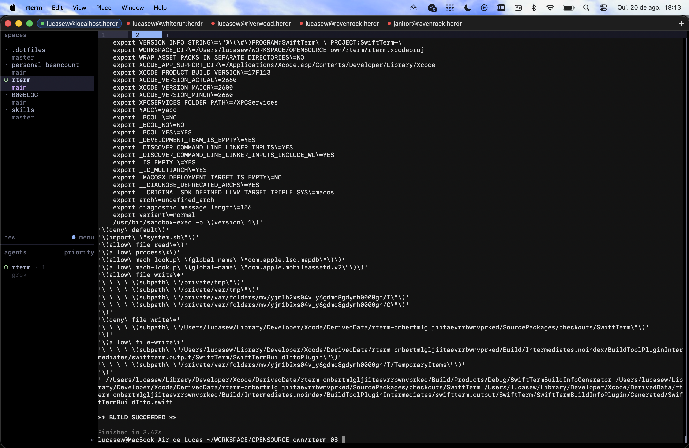
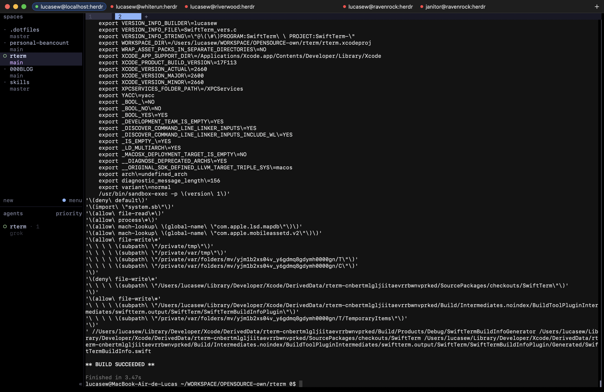

<p align="center">
  
</p>

# rterm

A desktop app that supervises detachable terminal sessions. It is not a general local-shell terminal.

Each tab is a **place**: a saved attach target. Click a tab to attach. Sleep drops the local process. The remote herdr, tmux, or screen session keeps running. Wake does not reconnect. Click the tab or choose Reconnect.





## Places

A place is user, routes, backend (`herdr`, `tmux`, or `screen`), and a session name for tmux and screen. One node may be open through several accesses: a Herdr tab, a tmux session `dev`, another `ops`. Each is its own tab, and they share the node's fingerprint, user, and routes. The duplicate key is user + fingerprint + access, so another login on the same machine is another tab, not a duplicate.

A node names one machine and pins its SSH host key fingerprint. It may have several routes: the endpoint you typed, `<name>.local` (mDNS), or a Tailscale MagicDNS name or IP. Routes are the whole truth; the first one is the typed endpoint, and a place with no routes is this machine. Reconnecting tries the route that worked last; when it fails, the pane lists the other ways in and the one you pick becomes the last route. **Reconnect as** in the tab menu lists every endpoint and marks the one in use. **New session** in the same menu, or ⌘N, opens another access to the node you are on; it lists the accesses already open there and suggests a backend that is not in use yet. The first verified route on an unpinned place teaches the fingerprint.

The catalog is `~/Documents/rterm/*.rterm-place`. The app writes it. Edits on disk reload. Use **+** or **Place → Add Place…**. Add Place asks only for **user** and an **endpoint** (hostname, IP, SSH alias, or an SSH address). The user is optional: empty uses your login. The endpoint is used verbatim, so an address that needs its own `@` (ShellHub's `namespace.device@cloud.shellhub.io`) keeps it and the user field adds the login in front. rterm never reads or writes `~/.ssh/config`; when the endpoint is an ssh alias, the `ssh` rterm runs resolves it as usual. The SSH host key fingerprint identifies the node; the endpoint is just one way to reach it. rterm connects once, reads the host key, and adds the endpoint to the node that owns that fingerprint, creating a tab only when no node has it yet. The same node reached through another address becomes another endpoint on the existing tabs, not a duplicate. A place from a v1 catalog has no fingerprint yet, so the verified endpoint completes it instead of adding a second tab. Editing a place keeps the full form with a **Find routes** button, and it edits that tab's access, not the node's identity.

```toml
version = 3

[[place]]
id = "0192F3C1-7A4E-7C3A-9B2D-1F0A2B3C4D5E"
user = "ada"
backend = "herdr"
fingerprint = "SHA256:C8olMcLxERkizT4dlzO1z85UVxdq/COQVR0T3I9IEK8"

[[place.route]]
kind = "direct"
host = "whiterun"
last = true

[[place.route]]
kind = "mdns"
host = "whiterun.local"

[[place.route]]
kind = "tailscale"
host = "whiterun.tailnet.ts.net"
```

There is no `host` field. A v1 or v2 catalog's `host` is read as the first route; the next save writes version 3 without it.

- No routes, `localhost`, or `127.0.0.1` is this machine. No SSH. Label: `you@localhost:herdr`.
- A real host uses `/usr/bin/ssh`. Label: `user@hostname:herdr` or `user@hostname:tmux(foo)`. The hostname is the route in use; a label replaces it, so label `work` shows `user@work:herdr`.

herdr attach uses the binary that owns `herdr.sock` on that machine. PATH `herdr` can be a different version.

The catalog is `~/Documents/rterm/*.rterm-place`. The app writes it. Edits on disk reload. Use **+** or **Place → Add Place…**.

Tab dots: grey idle, green alive, red failed. SSH keepalives make a dead path exit.

## Keyboard

| Shortcut | Action |
| --- | --- |
| ⌘1 … ⌘9 | Select place 1–9 |
| ⌘0 | Select place 10 |
| ⌘N | New session on the selected node |
| ⌘⇧N | Add place |
| ⌘R | Reconnect the selected place |
| Ctrl+⌘F | Enter or exit fill screen. On Linux, ⌘ is the Super key |
| ⌘V | Paste text, or an image-only clipboard as a PNG path |
| Ctrl+V | On a remote place, an image-only clipboard uploads like ⌘V. Any other Ctrl+V goes to the process |

An image-only paste writes `/tmp/rterm-paste-<id>.png` on the destination and types that path. A corner chip shows a spinner, Writing image… or Uploading image…, and a bar for bytes written. Remote upload uses the live SSH connection. Files larger than 10 MiB beep, show Paste failed, and do not paste.

One window only. Splits belong to herdr or tmux on the destination.

## Build

You need [mise](https://mise.jdx.dev/). On Linux, mise installs conda gcc. On macOS, use the system clang.

```bash
git clone https://github.com/lewtec/rterm.git
cd rterm
mise install
mise run
```

`mise run` builds and launches. `mise run test` runs the tests. `mise run ci` checks format, lint, tests, and the release build.

## Release

The public version is the git tag. `svu` picks the next tag. `Cargo.toml` stays `0.1.0`. Do not commit a version bump.

Same operator API as the other lewtec repos:

1. GitHub → Actions → Autorelease → Run workflow
2. Pick `next`, `patch`, `minor`, or `major`
3. GoReleaser builds the default Rust targets, attaches the universal DMG, and publishes the release

First release: pick **minor** (`0.1.0`). There are no tags yet, so `patch` would mint `0.0.1`.

Locally: `mise release minor`. A DMG without a GitHub release: `VERSION=0.1.0-dev mise package`.

`mise package` builds a universal (arm64 + x86_64) `rterm.app` and a styled installer DMG. It works on Linux and macOS: the HFS+ volume and the Finder `.DS_Store` are written by `packaging/dmg` in Go, so no `hdiutil` or `iconutil` is needed. The mounted DMG opens a Finder window with `rterm.app` on the left and an Applications drop link on the right. `VERSION=<tag> mise package --from-dist` packs slices that GoReleaser already built in `dist/`.

The app icon is one file, `packaging/icon.png`. `build.rs` derives every macOS icon size from it, and the packager derives the ICNS from the same file. No generated image is committed.

The DMG is unsigned. First open: right-click rterm → Open.

Design rules live in [SPEC.md](SPEC.md).
