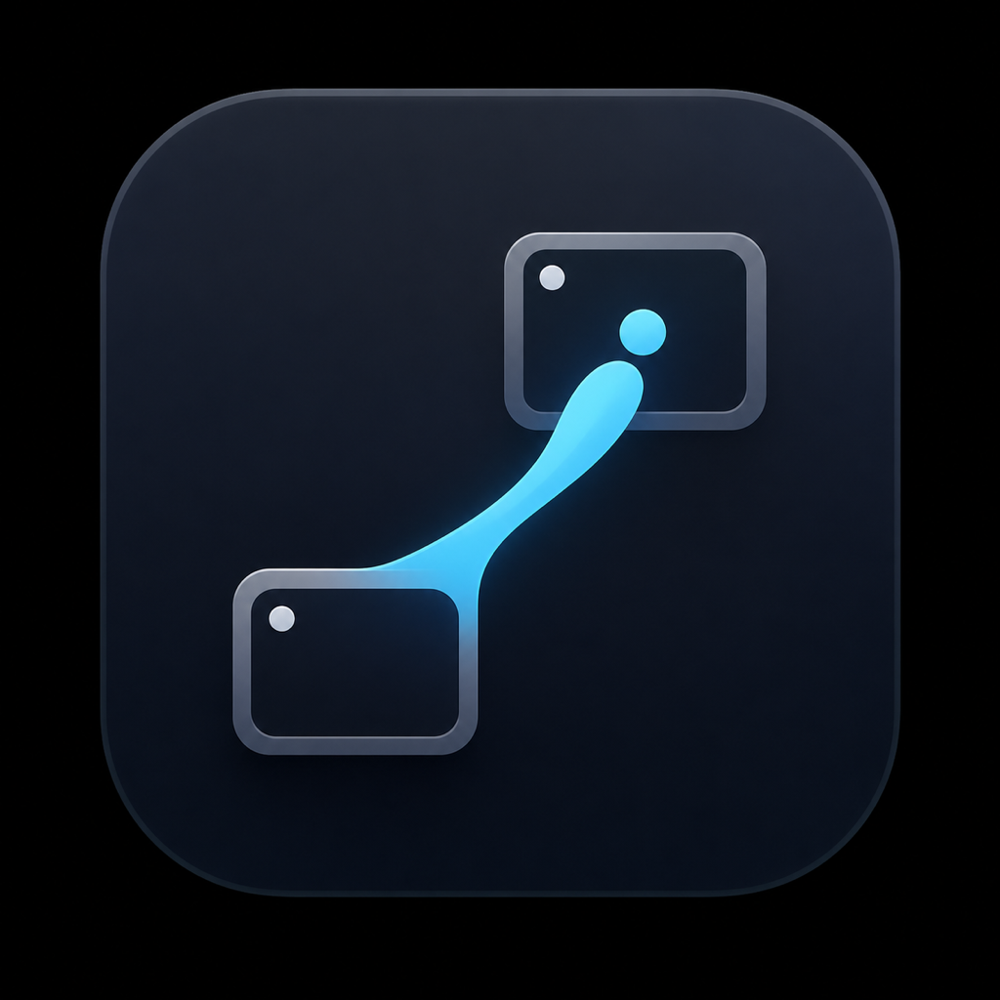
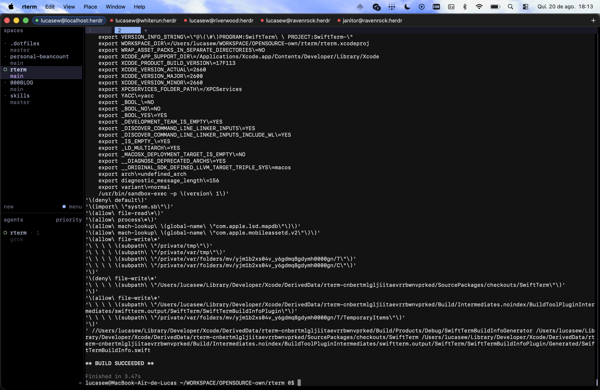
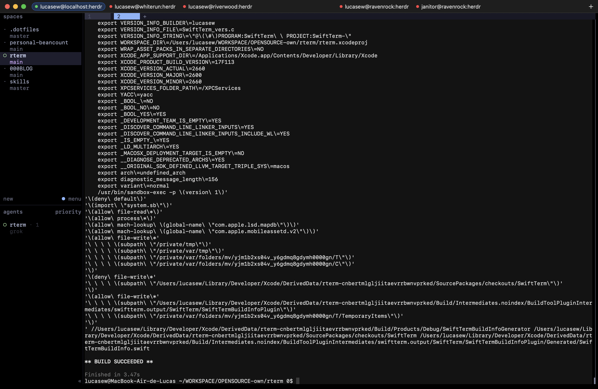

<p align="center">
  
</p>

# rterm

A desktop app that supervises detachable terminal sessions. It is not a general local-shell terminal.

Each tab is a **place**: a saved attach target. Click a tab to attach. Sleep drops the local process. The remote herdr, tmux, or screen session keeps running. Wake does not reconnect. Click the tab or choose Reconnect.





## Places

A place is user, host, and backend (`herdr`, `tmux`, or `screen`). tmux and screen also need a session name.

- Empty host, `localhost`, or `127.0.0.1` is this machine. No SSH. Label: `you@localhost:herdr`.
- A real host uses `/usr/bin/ssh`. Label: `user@host:herdr` or `user@host:tmux(foo)`.

herdr attach uses the binary that owns `herdr.sock` on that machine. PATH `herdr` can be a different version.

The catalog is `~/Documents/rterm/*.rterm-place`. The app writes it. Edits on disk reload. Use **+** or **Place → Add Place…**.

Tab dots: grey idle, green alive, red failed. SSH keepalives make a dead path exit.

## Keyboard

| Shortcut | Action |
| --- | --- |
| ⌘1 … ⌘9 | Select place 1–9 |
| ⌘0 | Select place 10 |
| ⌘N | Add place |
| ⌘R | Reconnect the selected place |
| Ctrl+⌘F | Enter or exit fill screen. On Linux, ⌘ is the Super key |
| ⌘V | Paste text, or an image-only clipboard as a PNG path |
| Ctrl+V | On a remote place, an image-only clipboard uploads like ⌘V. Any other Ctrl+V goes to the process |

An image-only paste writes `/tmp/rterm-paste-<id>.png` on the destination and types that path. A corner chip shows a spinner, Writing image… or Uploading image…, and a bar for bytes written. Remote upload uses the live SSH connection. Files larger than 10 MiB beep, show Paste failed, and do not paste.

One window only. Splits belong to herdr or tmux on the destination.

## Build

You need [mise](https://mise.jdx.dev/). On Linux, mise installs conda gcc. On macOS, use the system clang.

```bash
git clone https://github.com/lewtec/rterm.git
cd rterm
mise install
mise run
```

`mise run` builds and launches. `mise run test` runs the tests. `mise run ci` checks format, lint, tests, and the release build.

## Release

The public version is the git tag. `svu` picks the next tag. `Cargo.toml` stays `0.1.0`. Do not commit a version bump.

Same operator API as the other lewtec repos:

1. GitHub → Actions → Autorelease → Run workflow
2. Pick `next`, `patch`, `minor`, or `major`
3. GoReleaser builds the default Rust targets, attaches the universal DMG, and publishes the release

First release: pick **minor** (`0.1.0`). There are no tags yet, so `patch` would mint `0.0.1`.

Locally: `mise release minor`. A DMG without a GitHub release: `VERSION=0.1.0-dev mise package`.

`mise package` builds a universal (arm64 + x86_64) `rterm.app` and a styled installer DMG. It works on Linux and macOS: the HFS+ volume and the Finder `.DS_Store` are written by `packaging/dmg` in Go, so no `hdiutil` or `iconutil` is needed. The mounted DMG opens a Finder window with `rterm.app` on the left and an Applications drop link on the right. `VERSION=<tag> mise package --from-dist` packs slices that GoReleaser already built in `dist/`.

The app icon is one file, `packaging/icon.png`. `build.rs` derives every macOS icon size from it, and the packager derives the ICNS from the same file. No generated image is committed.

The DMG is unsigned. First open: right-click rterm → Open.

Design rules live in [SPEC.md](SPEC.md).
